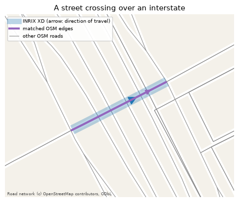
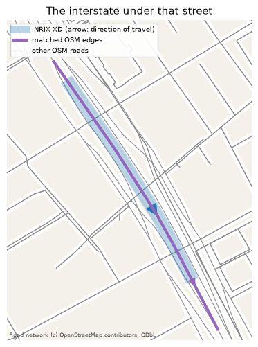
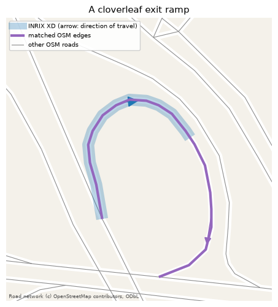
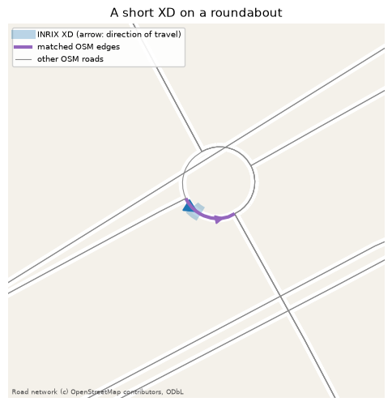

# Quick start
Match INRIX XD segments to OpenStreetMap (OSM) road edges in four steps.

1. **Install** (Python 3.11 or later):
   ```
   pip install geo_mapper_api
   ```
2. **Get two files** for your state from the INRIX [Data Download Service](https://docs.inrix.com/datadownload/datadownload/):
   - the map release **GeoJSON** of XD segments, for example `USA_Tennessee.geojson`;
   - the **OSM conflation CSV**, which lists the OSM ways under each XD, for example `USA_Tennessee.csv`.
3. **Run it** for one or more counties:
   ```python
   from geo_mapper_api import inrix_to_osm

   df = inrix_to_osm.serial("USA_Tennessee.geojson", "USA_Tennessee.csv", ["DAVIDSON"])
   df.to_csv("davidson_inrix_osm.csv", index=False)
   ```
   The first run downloads the county's road network from OSM, which can take a few minutes.
4. **Read the result**: one row per XD and OSM edge it runs along. `XDSegID` is the INRIX segment; `u`, `v` and `key` identify the OSM edge; `osmid` is one of its OSM ways and `highway` its road type. See [Usage](#usage) below for every column.

The sections below describe the input fields, the settings and how a match is decided.

# Examples
Matches on downtown Nashville. The light-blue band is an INRIX XD, its arrow showing the direction of travel; purple is the OSM edge the package matched to it. Grey lines are the other OSM roads nearby.

| | |
|---|---|
|  |  |
| A street over an interstate is matched only to the street, not to the interstate lanes below. | The interstate under it is matched only to the interstate, not to the street crossing over. |
|  |  |
| A cloverleaf ramp is matched along its curve, not to the road it leaves. | A short XD on a roundabout is matched to the roundabout edge running its way. |

Each OSM edge runs between two intersections, so an edge can extend past the end of the XD it is matched to, as on the ramp above.

# Setup
This needs Python 3.11 or later. It uses osmnx 2, geopandas 1 and pandas 2.1 or later.
```
pip install geo_mapper_api
```

# Requirements
It needs both the `OSMConflation` and `GeoJSON` data for the target area. You can obtain both from Inrix [Data Download Service](https://docs.inrix.com/datadownload/datadownload/) provided you have an access token or login credentials.

This conflation `csv` should have the following features:
| Feature                 | Type    | Example   |
| ----------------------- | ------- | --------- |
| XDSegID                 | Integer | 136894283 |
| OSMWayIDs               | String  | 19659968;19659970 |
| OSMWayDirections        | String  | N;N       |
| WayStartOffset\_m       | Float   | 1077.78   |
| WayEndOffset\_m         | Float   | 1851.31   |
| WayStartOffset\_percent | Float   | 33.706    |
| WayEndOffset\_percent   | Float   | 57.897    |

Only `XDSegID`, `OSMWayIDs` and `OSMWayDirections` are required. `OSMWayIDs` and `OSMWayDirections` hold `;`-separated lists of the same length.

The `geojson` data needs `County`, `XDSegID`, `FRC` (INRIX road class, 1 to 5), `RoadName` and a line geometry in EPSG:4326, drawn in the direction of travel. INRIX files also carry fields such as these:
| Feature    | Type     | Example            |
| ---------- | -------- | ------------------ |
| OID        | Integer  | 7931440            |
| XDSegID    | Integer  | 156418860          |
| PreviousXD | Float    | nan                |
| NextXDSegI | Float    | 395960459.0        |
| FRC        | Integer  | 4                  |
| RoadNumber | Float    | nan                |
| RoadName   | String   | DRHESSRD           |
| LinearID   | Float    | nan                |
| Country    | String   | UNITEDSTATES       |
| State      | String   | TENNESSEE          |
| County     | String   | HAYWOOD            |
| District   | Float    | nan                |
| PostalCode | String   | 38006              |
| Miles      | Float    | 0.5902665205613952 |
| Lanes      | Float    | 1.0                |
| SlipRoad   | Integer  | 0                  |
| SpecialRoa | Float    | nan                |
| RoadList   | String   | DRHESSRD           |
| StartLat   | Float    | 35.67248           |
| StartLong  | Float    | -89.14147          |
| EndLat     | Float    | 35.666218484838986 |
| EndLong    | Float    | -89.13571015096953 |
| Bearing    | String   | S                  |
| XDGroup    | Integer  | 2013963            |
| ShapeSRID  | Integer  | 4326               |
| geometry   | Geometry | LINESTRING         |

# Usage
Give it the map release GeoJSON, the conflation CSV, and one or more county names. County names are matched case-insensitively.
```python
import os

from geo_mapper_api import MatchConfig, inrix_to_osm

DATA_DIR = "./data"
geojson_path = os.path.join(DATA_DIR, "USA_Tennessee.geojson")
csv_path = os.path.join(DATA_DIR, "USA_Tennessee.csv")

if __name__ == "__main__":
    df = inrix_to_osm.parallel(geojson_path, csv_path, ["WILLIAMSON", "DAVIDSON"], config=MatchConfig())
    df.to_csv(os.path.join(DATA_DIR, "inrix_osm.csv"), index=False)
```
`parallel` runs each county in its own process, using every CPU core but `reserved_cores` (2 by default). It must be called under `if __name__ == "__main__":`, because the worker processes import your script again. `serial` takes the same arguments, runs one county at a time, and needs no guard. `config` is optional; leaving it out uses the defaults below.

## Matching on a saved OSM file
By default the roads are downloaded from OpenStreetMap as they are on the day of the run. To match on a file you already have, such as the one a routing engine (Valhalla, OSRM) was built from, pass it as `osm_xml`:
```python
df = inrix_to_osm.serial(geojson_path, csv_path, ["DAVIDSON"], osm_xml="./data/tennessee_roads.osm")
```
No download is made. `u` and `v` are then the file's OSM node ids, so the matches line up with whatever else was built from that file, and two runs on the same file give the same result. The file's ways go through the same road filter and the same steps as a download.

The file must be OSM XML (`.osm`). A `.osm.pbf` extract has to be converted first, for example with `osmium cat tennessee-latest.osm.pbf -o tennessee.osm`. Cutting it to the area first (`osmium extract`) keeps the read fast.

## How a match is decided
The road network comes from OSM. It holds every way with a `highway` tag that is not drawn as an area, including service roads (driveways, parking aisles, alleys) and private roads. It leaves out footways, cycleways, paths, steps, pedestrian streets, bridleways, corridors, elevators, escalators, ladders, tracks, raceways, platforms, bus stops, trailheads, and roads that are under construction, proposed, planned, abandoned or razed.

For each XD, an OSM edge is matched when:
1. it carries an OSM way that INRIX's conflation lists for the XD;
2. it points the XD's direction of travel where they meet (INRIX's P/N flag is compared with this on two-way streets, and disagreements are logged as warnings);
3. it runs along the XD: inside a band `band_half_width_m` either side of the XD, cut square at the XD's ends, the edge reaches at least `min_overlap_m` along the XD (half the XD's length for XDs shorter than twice that). Cross streets and the next block past the XD's end reach almost nowhere along it, so they are not matched.

An XD whose matches cover less than `fallback_below_coverage` of its length (usually because INRIX's way IDs are out of date) is searched again by geometry alone. Fallback matches are limited to general-traffic roads, which are `motorway`, `trunk`, `primary`, `secondary` and `tertiary` with their `_link` ramps, `unclassified`, `residential`, `living_street` and `road`. Service roads, busways and rest areas are matched only through INRIX's way IDs. Fallback matches must also pass a road-level rule: an interstate XD (`RoadName` starting `I-` and a digit) only matches `motorway` or `motorway_link` edges, and a non-interstate XD of road class 3 to 5 never matches a `motorway` edge. An XD with no `RoadName` is judged by its road class, so an unnamed interstate XD can lose motorway matches but never gains wrong ones.

## Settings
Every tunable number lives in `MatchConfig`. Distances are in meters.

| Setting | Default | Meaning |
|---|---|---|
| `band_half_width_m` | 15.0 | half-width of the band around each XD |
| `min_overlap_m` | 10.0 | how far an edge must run along its XD inside the band |
| `fallback_below_coverage` | 0.9 | XDs covered less than this share are searched by geometry; 0 turns the fallback off |
| `hull_buffer_m` | 200.0 | margin around the county's XDs for the OSM download |
| `reserved_cores` | 2 | CPU cores `parallel` leaves free |

Settings can come from a TOML file of top-level keys; keys left out keep their defaults:
```toml
band_half_width_m = 20
min_overlap_m = 10
```
```python
config = MatchConfig.from_toml("matching.toml")
```
A wrong type raises `TypeError` and an invalid value raises `ValueError`, both naming the setting (and the file, for `from_toml`).

## Known limits
- An XD drawn more than `band_half_width_m` from every OSM road stays unmatched or partly covered. This happens when the road was realigned, when OSM tags it as a track or a road under construction, which the road filter leaves out, or when it is a service road cut off from the rest of the network, which osmnx drops.
- An edge leaving the XD at an acute angle, such as a diverging ramp, can stay inside the band for 10 m or more and be matched. This mainly affects fallback matches, since a diverging road is usually a different OSM way.
- Limited-access parkways that OSM tags `motorway` but INRIX classes 3 to 5 cannot be recovered by the fallback; their way-ID matches are unaffected.

The result has one row per OSM edge and XD segment pair:
| Column           | Type     | Example                                   |
|------------------|----------|-------------------------------------------|
| u                | int      | 202619796                                 |
| v                | int      | 202705554                                 |
| key              | int      | 0                                         |
| osmid            | int      | 19495638                                  |
| highway          | str      | primary                                   |
| XDSegID          | int      | 1524404117                                |
| osm_geom         | geometry | LINESTRING (-86.7801 36.1602, ...)        |
| inrix_geom       | geometry | LINESTRING (-86.7800 36.1603, ...)        |
| overlap_m        | float    | 88.4                                      |
| source           | str      | conflation                                |
| county           | str      | DAVIDSON                                  |

- `u`, `v` and `key` identify the edge in the osmnx graph.
- `osmid` is the OSM way that links the edge to the XD (the smallest, when several do). For `source == "geometry"` rows it is the smallest way ID on the edge.
- An osmnx edge can carry several OSM ways and `osmid` shows only one of them, so `osmid` is no join key. Join results to an osmnx graph or to other per-edge data on `u`, `v` and `key`.
- `highway` is the edge's OSM road type, such as `primary` or `service`. When osmnx merged ways of different types into one edge, it lists them sorted and joined with `;`, such as `residential;service`. It covers the whole edge, so it can name more types than the way in `osmid`, and it is never missing.
- `df[df["highway"] != "service"]` drops rows on edges that are only service roads. To keep only the general-traffic roads the fallback may match, filter with the package's own rule.
  ```python
  from geo_mapper_api.matching import fallback_type_allows

  df = df[df["highway"].map(fallback_type_allows)]
  ```
- Geometries are in EPSG:4326 (longitude, latitude).
- `overlap_m` is how far the edge runs along the XD, in meters.
- `source` is `conflation` for matches through INRIX's way IDs and `geometry` for fallback matches.
- `county` holds the upper-cased county name.

# Errors
- `config` that isn't a `MatchConfig` raises `TypeError` before anything is read.
- Bad inputs raise `ValueError` before any county is processed. This covers a missing column, an unknown county, an empty county list, a missing or non-integer ID, an FRC outside 1 to 5, an empty or zero-length XD line, geometries not in EPSG:4326, and a conflation row whose way and direction lists differ in length. The message names the file, the column and the offending values.
- A failure while processing a county raises `RuntimeError` with a message like `county 'DAVIDSON' failed: ConnectionError: ...`.

# Logging
The package logs through Python's `logging` module and writes no files itself. To keep its logs:
```python
import logging
import os

os.makedirs("log", exist_ok=True)
logging.basicConfig(filename="log/geo_mapper.log", level=logging.DEBUG)
```

# Development
```
python3.12 -m venv .venv
.venv/bin/pip install -e ".[dev]"
.venv/bin/pytest
```
The unit tests run on small hand-made data and need no network.

The integration test runs on real INRIX data for downtown Nashville. The data is licensed, so it is never committed, and `tests/data/` is gitignored. Build it, then point the test at it:
```
.venv/bin/python scripts/make_test_data.py --geojson-src HOST:/path/USA_Tennessee.geojson --csv-src HOST:/path/conflation.csv
GEO_MAPPER_TEST_DATA=tests/data .venv/bin/pytest
```
The first run downloads the OSM network into `tests/data/osm_cache`. Later runs reuse it.

To compare this version's output with an earlier commit on the same data, run `scripts/compare_versions.py --base <commit> --base-python <a Python with that commit's dependencies>`. The base must be 0.3.0 or later. It prints a table per area and saves it under `log/`. Its download size and first-run time are only meaningful with an empty `osm_cache`, so give it a data folder of its own. `make_test_data.py` also writes all of Davidson County, which `--areas davidson` compares:
```
.venv/bin/python scripts/compare_versions.py --base v0.3.0 --base-python .venv/bin/python --data <folder with davidson.geojson and davidson.csv> --areas davidson
```

# Releasing
Set the new `version` in `pyproject.toml`, merge it to `main`, then push a matching tag such as `git tag v0.2.0 && git push origin v0.2.0`. The publish workflow checks that the tag matches the version and uploads to PyPI.
